

  

<h1 align="center">SakuraMedia</h1>

  <strong>把本地和网盘里的影片，变成可搜索、可订阅、可续看的媒体库。</strong>

  面向自建媒体库的用户：后端可部署在 NAS、迷你主机、服务器或 VPS 上；影片可以存本地，也可以存 115 网盘。

> [!WARNING]
> **请将前后端同步升级至 v0.15.0 才能正常使用；v0.15.0 之前的版本已无法正常使用。**

  <a href="https://github.com/tinypinglite/sakuramedia/releases"><strong>下载客户端</strong></a>
  ·
  <a href="https://tinypinglite.github.io/sakuramedia/zh-CN/guide/quick-start"><strong>部署后端</strong></a>
  ·
  <a href="https://tinypinglite.github.io/sakuramedia/zh-CN/"><strong>查看 Wiki</strong></a>
  ·
  <a href="https://tinypinglite.github.io/sakuramedia/videos/sakuramedia-demo.mp4"><strong>看演示</strong></a>

  
  

  <a href="./README.md">English</a> · <strong>简体中文</strong>

  需要一台 24 小时运行的主机 + Docker；客户端不能单独使用。

  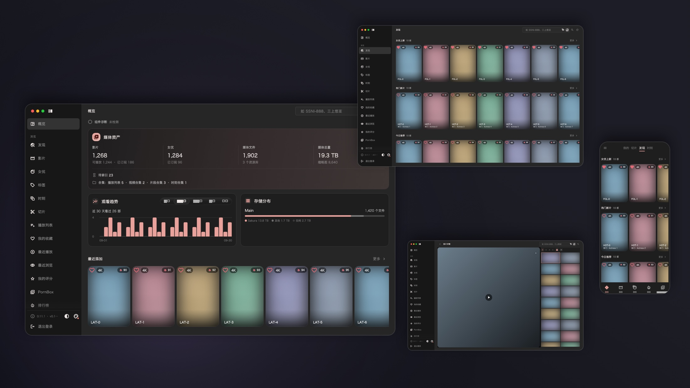

  收藏久了，我开始在意：这部影片里，我究竟想留下什么？ 
  <a href="https://tinypinglite.github.io/sakuramedia/zh-CN/guide/collection-strategy"><strong>为什么做 SakuraMedia →</strong></a>

## 核心功能

从找片、下载到观看和整理，当前版本覆盖以下能力。

### 找片与获取

- 🔍 **发现与订阅**：按番号搜索、按姓名查找女优；标签、排行榜、推荐；订阅女优持续追踪新作（不会自动下载她的全部作品）。
- 📥 **自动下载与入库**：订阅影片后定期寻找资源，通过存储扩展插件提供的下载功能；完成后自动导入媒体库，暂无资源的影片留在订阅清单。
- 📦 **导入与信息补全**：导入本地磁盘、 部分网盘；识别番号，刮削并补全标题、演员、封面等信息；识别失败可手动匹配。

### 观看与留下

- 🎬 **播放与时刻**：缩略图时间轴定位画面；标记时刻；把一段画面切成独立视频；支持倍速、字幕、续播和外部播放器。
- 🥽 **VR 播放**：调用外部播放器播放 VR 影片；多分段资源可合并连续播放。
- 🖼️ **以图搜图**：用缩略图、剧情图或文字描述，找其他影片里的相似画面；有可播放来源的结果可直接跳到对应时间（可选，需额外部署嵌入服务；只搜已索引的库内图片）。
- ❤️ **收藏与整理**：播放列表、时刻合集、切片合集；用合集组织想回看的内容。

> 时刻依赖来源媒体；切片是独立视频文件。

### 多元化的存储与下载层

* 📥 **可扩展的存储与下载层**:  不限制影片的存储位置， 存在本地 / 云端 由你来决定， 官方的扩展插件已支持 三种方式。
* 💾  **本地存储与qBittorrent**: 适合有Nas和大硬盘以及PT站点的用户， 下载功能由qBittorrent提供。
* ☁️ **云盘服务商** : 适合本地没有太多存储空间，希望将影片存储在云端的用户， 已支持115网盘和光鸭云盘。

### 普通视频（PornBox）

- 📼 **普通视频导入**：在「媒体导入 → 视频」选择存储中的目录或视频文件，导入时可直接加入合集；不需要番号，也不走 JAV 的订阅与下载流程。
- 🗂️ **合集组织**：在合集详情查看成员、手动排序，加入或移出成员；点「播放全部」按当前顺序开始。
- 🔗 **合集连播**：右侧缩略图面板把各集关键帧拼成一条；滚动或点选即可跳到对应视频和画面，播完自动进入下一部。
- 📌 **连播中标记时刻**：缩略图右键 →「添加标记」；时刻仍绑定具体视频和媒体，不会因为连播丢失。同一菜单也可以保存到本地；启用以图搜图后还能搜相似图片。

> PornBox 与 JAV 的番号、订阅和下载流程相互独立；合集只负责组织已经入库的普通视频。

### 管理与扩展

- 🗂️ **媒体库管理**：查看重复文件、多版本和失效媒体；采样文件指纹只读少量片段，跨库/跨存储识别重复。把本地影片通过 115 秒传迁移到网盘，保留媒体记录与播放进度；未命中会跳过并保留源文件。
- 🔔 **任务与通知**：任务中心查看下载、导入和后台任务；通知提醒，通知渠道可扩展。
- 🧩 **插件扩展**：存储、下载、排行榜、字幕、女优资料补全等能力通过插件接入。
- 💻 **多客户端**：Windows / macOS / Linux（Beta） / Android / iOS；桌面端负责配置和集中管理，移动端用于浏览和观看，具体入口因平台而异。

## 界面

> 截图使用演示数据，封面与缩略图已虚化。完整演示见下方视频。

  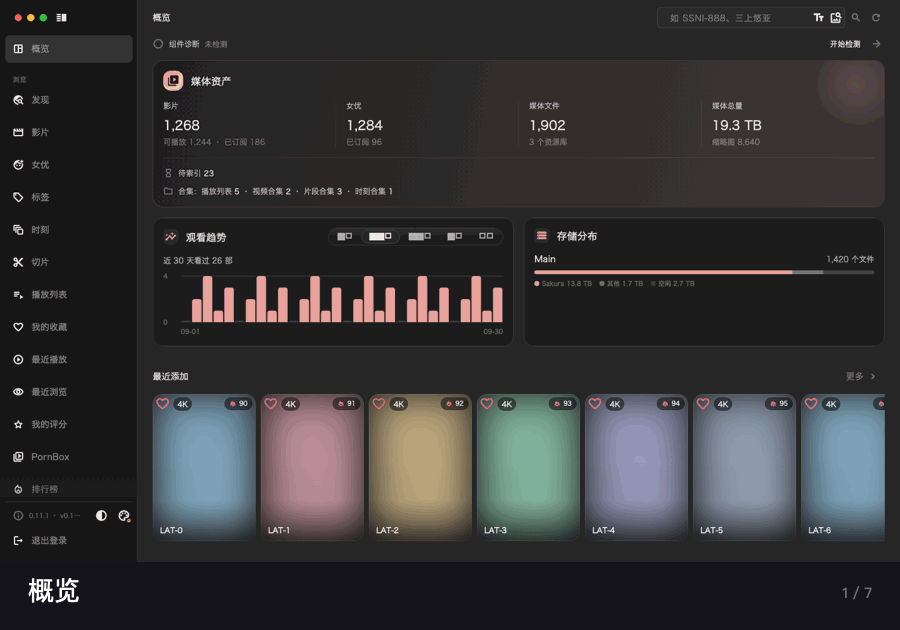

  概览 / 发现 / 详情 / 播放器 / 切片 / PornBox

  <a href="https://tinypinglite.github.io/sakuramedia/videos/sakuramedia-demo.mp4"><strong>▶ 看 45 秒完整演示</strong></a>

<strong>更多截图</strong>

  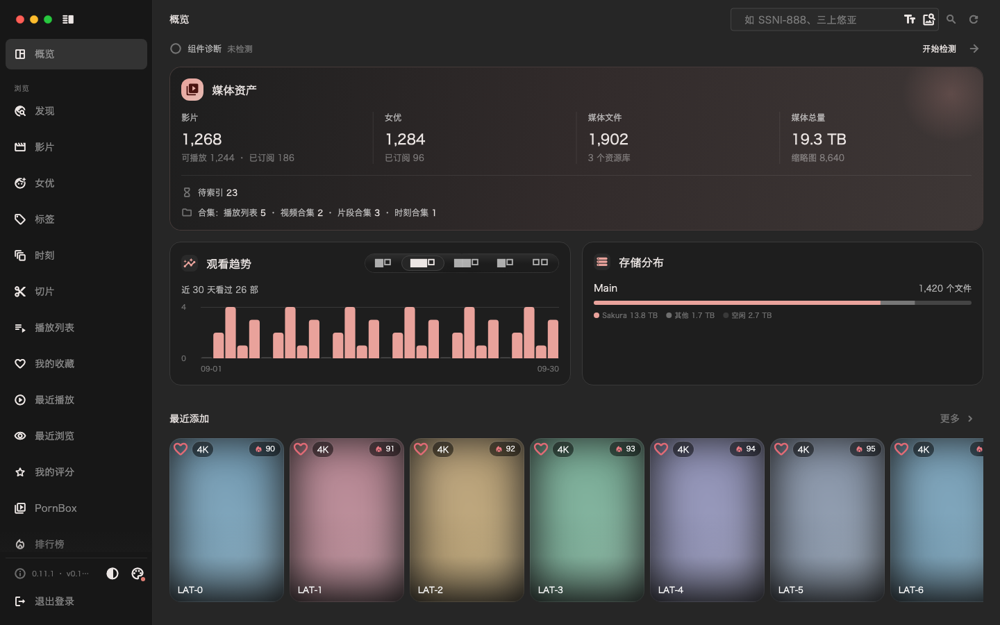

  概览：媒体资产、观看趋势、存储分布

  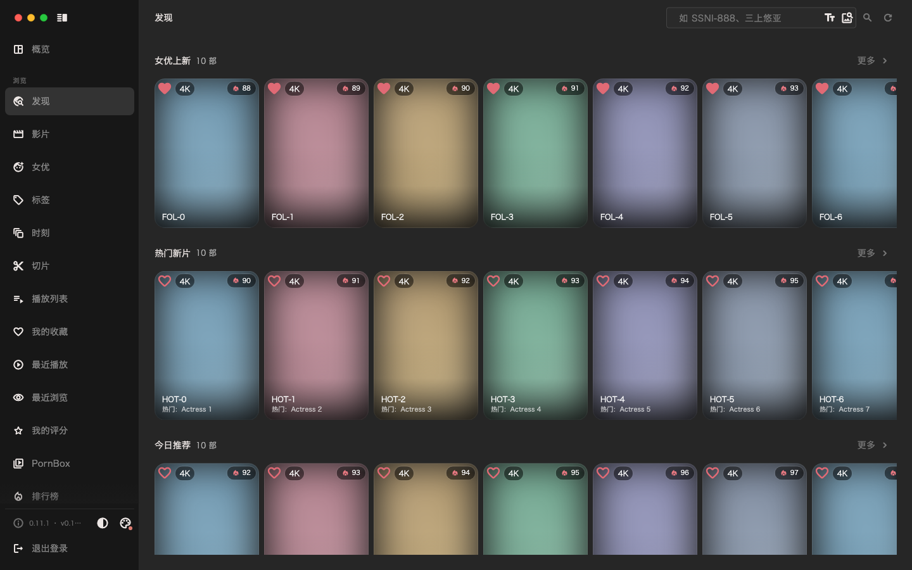
  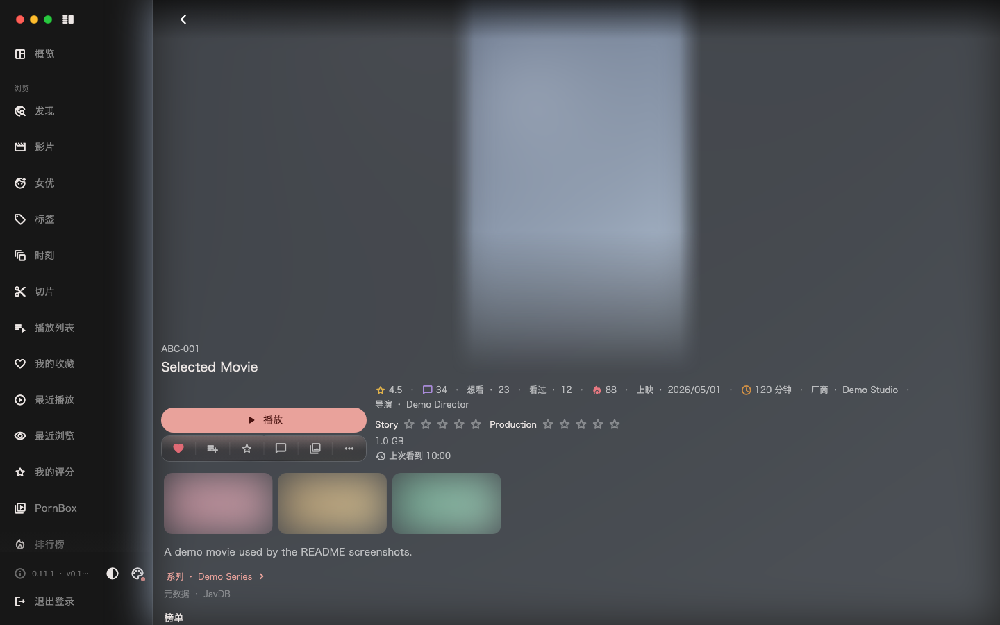

  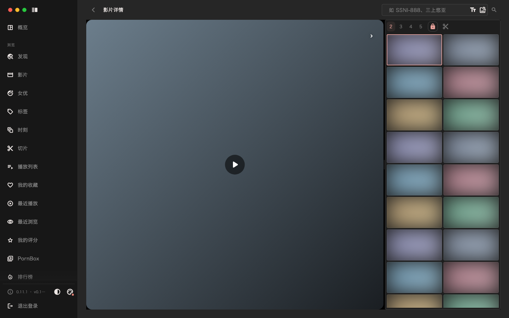

  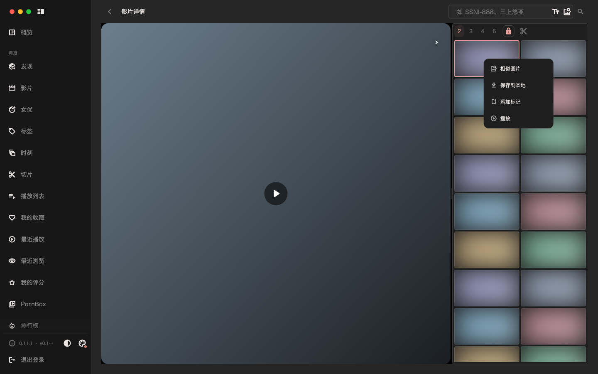

  从缩略图右键 → 相似图片

  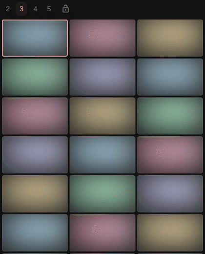
  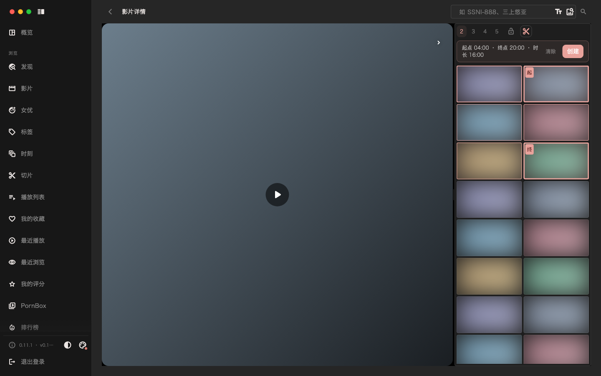

  缩略图时间轴 / 圈选切片

  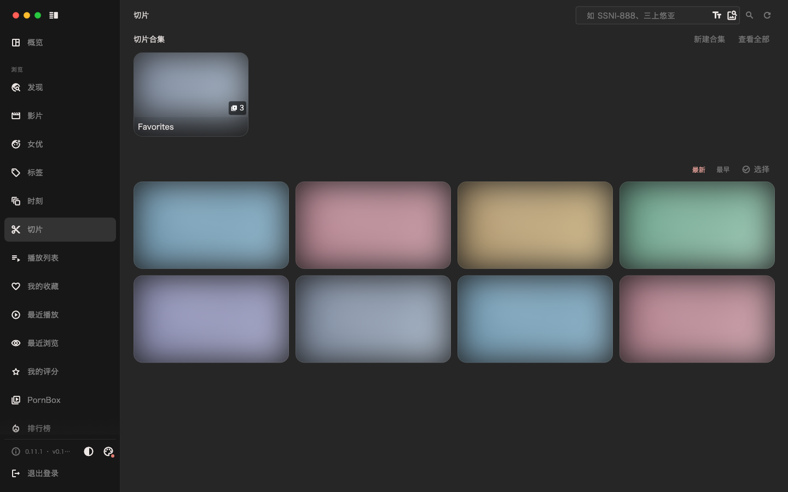

  切片页：浏览、播放、加入合集

  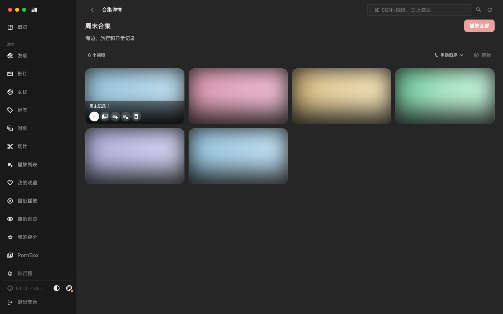

  PornBox 合集：成员、手动顺序、播放全部

  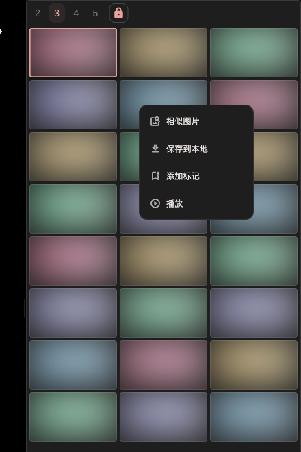

  合集连播：缩略图面板按合集拼接；右键 → 添加标记

  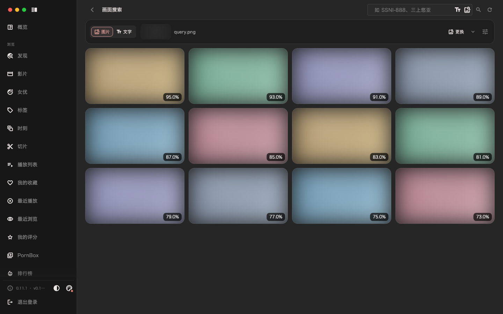

  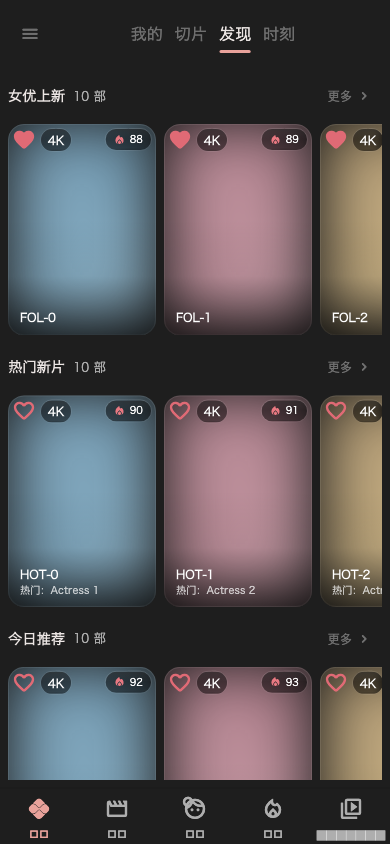

## 下载与安装

客户端不能单独使用，需要连接一台已经部署好的 SakuraMedia 后端。请从 [GitHub Releases](https://github.com/tinypinglite/sakuramedia/releases) 下载对应平台的安装包。

Linux 客户端目前为 **Beta**，仅提供 x86_64 Flatpak 安装包，系统需要已安装 Flatpak。Linux 版暂不支持内嵌网页登录，需要登录的媒体库请使用插件提供的手动登录配置。

| 平台 | 安装包 | 说明 |
| --- | --- | --- |
| Windows | `sakuramedia-windows-<版本>-setup-unsigned.exe` | 安装包未签名；SmartScreen 提示时选择「更多信息 → 仍要运行」 |
| macOS | `sakuramedia-macos-<版本>.dmg` | 使用固定自签名证书，未经过 Apple 公证；系统提示来源不明时在「隐私与安全性」中允许 |
| Linux（Beta） | `sakuramedia-linux-<版本>-x86_64.flatpak` | 需要 Flatpak；使用 `flatpak install --user <文件>` 安装 |
| Android | `sakuramedia-android-<版本>-release-signed.apk` | 直接安装；系统可能提示未知来源 |
| iOS | `sakuramedia-ios-<版本>-sidestore-ready.ipa` | 需要 iOS 15.0+，通过 SideStore 或自签工具安装；没有侧载经验建议先用桌面端 |

## 是什么/不是什么

**是什么** 

1. `sakuramedia`是一个前后端分离的项目，**客户端无法单独使用**，需要你有一台7*24开机的小主机/NAS部署后端。  

2. `sakuramedia` 客户端由`flutter`驱动，同时提供了`windows` `macos` `linux` `android` 以及 `iOS` 平台安装包(无Web平台)，其中 Linux 客户端目前为 Beta，定位是配合**`sakuramedia`后端**实现浏览、管理、观影一体化的体验。 本项目是独立于目前常见影视库生态之外的项目， 例如 emby 飞牛影视 jellyfin plex， `sakuramedia` 和他们没有任何关系，也没有任何兼容它们生态的计划。

3. `sakuramedia`的核心理念是专注于建立专属自己的观影“遗产”，如观影过程产生的时刻、切片、以及对影片番号的记录，如播放列表、标签等， `sakuramedia`特意弱化了影片文件本身的存在，也不提供类似于指定目录结构来整理影片资源的功能， 我们认为`jav`这类影片文件本身是可再生的， 我们只需要知道我曾经观看过哪部影片， 第xx秒的画面我很喜欢，`sakuramedia`负责把他们记下来，即使之后的某天，影片因为硬盘损坏文件丢失了，但记录还在，这就够了， `sakuramedia`能够识别到丢失文件的影片记录， 只需要处理一下，让自动下载的模块将这个影片重新下载回来即可。

**不是什么**  

1. `sakuramedia`和jav 刮削历史上出现过的项目有一个本质的区别， 刮削只作为整个流程中很小的一部分， 我们专注于媒体库的建立、浏览、下载、以及观影。 这意味着，你不需要装类似于jellyfin emby之类的来配合使用， `sakuramedia` 足以满足你所有的需求。
2. `sakuramedia` 有一定的配置难度，并非面向小白用户， 这也算是一种筛选用户的策略，避免泛滥。
3. SakuraMedia 本身不提供任何影片资源，也不内置任何资源站点。

## 社区与支持

- 发现 Bug 或有功能建议：[提交 Issue](https://github.com/tinypinglite/sakuramedia/issues)。请附上客户端、后端和插件版本、复现步骤与相关日志；请勿上传不宜公开的影片截图、封面或个人信息。
- 使用交流或求助：[参与 Discussions](https://github.com/tinypinglite/sakuramedia/discussions)。
- 遇到连接或导入问题，先在「概览 → 组件诊断」检查媒体库、索引器、JavDB 和嵌入服务的连通性。
- 也可以把 `wiki/` 目录的 Markdown 交给 AI，说明你的问题和已尝试的步骤，通常能更快定位。
- 项目处于快速迭代阶段；升级前请查看 Release 说明，前后端与插件尽量一起升级。

## 参与贡献

- [点一个 Star](https://github.com/tinypinglite/sakuramedia/stargazers)，让更多人看到这个项目。
- 帮助改进 [Wiki](https://tinypinglite.github.io/sakuramedia/zh-CN/) 和文档。
- 开发插件：查看 [插件开发文档](https://tinypinglite.github.io/sakuramedia/zh-CN/guide/plugin-development)；上架插件市场请前往 [sakuramedia-plugin-market](https://github.com/tinypinglite/sakuramedia-plugin-market)。
- 欢迎提交 bug 修复或新功能 PR；客户端源码就在本仓库。

本项目不需要捐赠；Star、文档和插件都是帮助。

## 风险与声明

- 本项目仅用于技术交流，不提供任何影片资源或下载链接。
- 用户使用本工具产生的一切后果由使用者自行承担，与作者无关。
- 请在使用前了解并遵守当地法律法规；如使用行为违反当地法律，请勿使用。
- 禁止将本软件用于商业用途。
- 若不同意上述任意一条，请勿使用。
- License: [PolyForm Noncommercial 1.0.0](./LICENSE)

<h2 align="center">Star History</h2>

  <a href="https://github.com/tinypinglite/sakuramedia/stargazers">
    <picture>
      <source media="(prefers-color-scheme: dark)" srcset="https://tinypinglite.github.io/sakuramedia/star-history-dark.svg" />
      <source media="(prefers-color-scheme: light)" srcset="https://tinypinglite.github.io/sakuramedia/star-history-light.svg" />
      
    </picture>
  </a>

